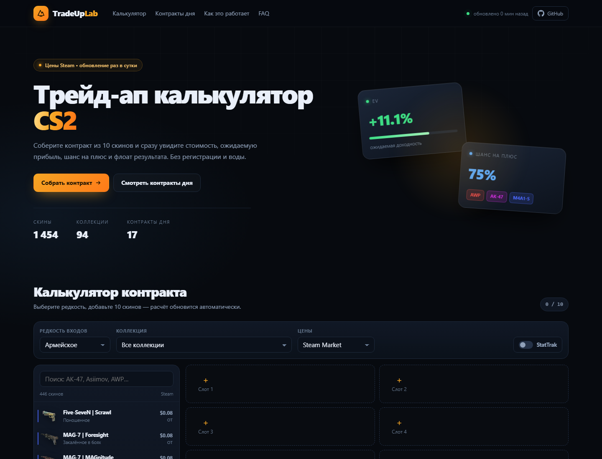

# TradeUp Lab

Калькулятор трейд-ап контрактов CS2 с живыми ценами Steam и готовыми «контрактами дня».
Статический сайт без бэкенда: всё считается в браузере, данные обновляются GitHub Actions.

**Live:** https://kolaars.github.io/tradeup-lab/



## Что внутри

- **Калькулятор контракта** — 10 слотов, выбор wear и флоата, стоимость, EV, ROI, шанс на плюс.
- **Контракты дня** — автоматический поиск трейд-апов с положительной оценкой по текущим ценам.
- **Учёт механики** — редкости, коллекции, StatTrak, диапазоны флоата и формула выходного флоата.
- **Поделиться расчётом** — состояние контракта кодируется в URL.
- **Без регистрации, без бэкенда, без API-ключей.**

## Стек

Ванильный HTML/CSS/JS (ES modules), Node.js только для сборки данных. Ноль npm-зависимостей.

```
index.html              интерфейс
assets/app.js           логика UI и состояние
assets/tradeup.js       математика трейд-апов (общая для браузера и Node)
assets/styles.css       стили
assets/config.js        партнёрские коды и ссылки (монетизация)
scripts/build-data.mjs  сборка data/items.json и data/deals.json
data/                   сгенерированные данные (коммитятся)
.github/workflows/      ежедневное обновление цен
```

## Локальный запуск

```bash
node scripts/serve.mjs
# http://localhost:5173
```

Обновить цены и пересобрать данные:

```bash
node scripts/build-data.mjs
```

Скрипт кеширует метаданные скинов на 6 часов в `.cache/`, цены тянет при каждом запуске.

## Данные

| Что | Источник |
| --- | --- |
| Скины, коллекции, редкости, флоаты | [ByMykel/CSGO-API](https://github.com/ByMykel/CSGO-API) |
| Цены (Steam Market и минимальные листинги) | Публичный API [Waxpeer](https://waxpeer.com/) |
| Изображения | CDN Waxpeer / Valve |

Цены хранятся в тысячных долях доллара (milli-USD), чтобы не терять точность на дешёвых скинах.
Покрытие ценами — около 98.6% карточек скинов.

### Почему «контракты дня» могут быть в плюсе

Калькулятор берёт 10 самых дешёвых входов коллекции и считает EV по среднему флоату.
Это оценка, а не гарантия: цены меняются, ликвидность ограничена, комиссии не учтены.
В карточке показывается и «худший флоат» — сценарий, при котором выход попадает в худший wear.

## Деплой

Сайт рассчитан на GitHub Pages из ветки `main` (корень репозитория):

1. Репозиторий публичный.
2. Settings → Pages → Source: **Deploy from a branch**, branch `main`, folder `/ (root)`.
3. Ежедневный workflow `.github/workflows/update-prices.yml` коммитит свежие `data/*.json`, Pages подхватывает изменения автоматически.

Для своего домена: измените `canonical`, `og:url`, `sitemap.xml`, `robots.txt` и `CNAME`.

## Монетизация

Инструкция и честные ожидания — в [MONETIZATION.md](MONETIZATION.md).
Коротко: партнёрские ссылки на маркетплейсы + AdSense после переезда на свой домен + донаты.
Коды вставляются в `assets/config.js`, интерфейс подстраивается сам.

## Ограничения и дисклеймер

- Не является финансовой рекомендацией.
- Не связан с Valve, Steam или Waxpeer. CS2 — торговая марка Valve.
- Комиссии Steam (~15%) и маркетплейсов не учитываются.
- StatTrak-контракты требуют 10 StatTrak-скинов; Souvenir не участвует.

## Лицензия

Код — MIT (см. [LICENSE](LICENSE)).
Данные и изображения принадлежат их правообладателям; метаданные — ByMykel/CSGO-API (CC BY 4.0).
